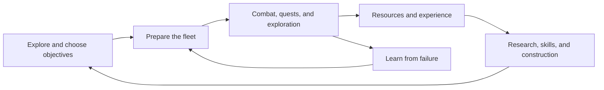

# Vision

[Game design index](index.md)

## Purpose

The player grows from a lightly equipped pilot into a fleet commander through exploration, construction, and combat.
Ships, technology, and territorial progress provide persistent evidence of that growth.

The central creative activity is building a ship that solves a problem.
The galaxy supplies those problems through enemies, resource needs, environmental hazards, and faction encounters.

## Player actions and core loops

### Campaign loop

1. Inspect nearby stars, threats, services, and quest objectives.
2. Choose a destination and prepare the active fleet.
3. Travel and resolve the destination's encounters.
4. Collect rewards or respond to failure.
5. Trade, research, craft, refit, or spend skill points.
6. Use the improved fleet to pursue another objective.

### Construction loop

1. Identify a weakness, such as insufficient range, energy, mobility, or protection.
2. Choose equipment that addresses that weakness within the hull's restrictions.
3. Set weapon and device controls.
4. Test the result in combat or exploration.
5. Use the outcome to revise the build.

### Long-term loop

1. Discover new regions and their factions.
2. Acquire research and useful ships or components.
3. Develop skills and specialized builds.
4. Complete harder encounters and change regional state.
5. Extend exploration into more demanding parts of the galaxy.

## Current rules and product boundaries

The star map connects persistent progression to separate combat and exploration scenes.
Ordinary combat deploys one player ship at a time from the active fleet; equipment can provide drones and other support.
The player therefore builds a roster of options rather than directly commanding every owned ship simultaneously.

Campaign progress includes ships, inventory, skills, research, discovery, quest progress, and regional state.
Special activities can replace the normal fleet, reward rules, or ship-selection rules.
The arena uses uploaded opponent fleets and local AI combat. It is asynchronous player-versus-player play.

The repository supports PC, mobile, and web builds. Services and some economic rules differ between builds.
The current source does not establish a universal campaign ending or a fixed completion time.
The design remains a persistent exploration sandbox with authored quests.

## System connections

The detailed rules belong to [Galaxy](galaxy.md), [Combat](combat.md), [Progression](progression.md), and [Economy](economy.md).

## Design intent and open questions

The following principles carry forward the previous game design document.

| Pillar | Design requirement |
| --- | --- |
| Exploration creates opportunity and danger | Discovery should create useful choices. Greater risk should have understandable rewards. |
| Construction is a creative problem | Layout, energy, mobility, protection, and weapon roles should require trade-offs. |
| Preparation and piloting both matter | A strong build should support skillful play without making execution irrelevant. |
| Risk becomes persistent growth | Rewards should open new choices as well as increase numerical power. |
| The faction sandbox reacts | Important quest and territorial outcomes should remain visible across sessions. |
| Challenge requires adaptation | Encounter variety should test different capabilities instead of relying only on inflated stats. |

Content should add recognizable roles, counters, and interactions.
Faction identities should appear in equipment and encounters as well as presentation.
Early choices should permit recovery, while advanced construction should reward understanding.
No hull, weapon, or fleet composition should solve every encounter equally well.

Monetization should not be required to understand or enjoy the core loop.
That is an intent statement, not a finding about the current economy.
Premium costs and build differences need evaluation against it.

Open questions:

1. What player milestone defines a satisfying late-game achievement beyond continued numerical growth?
2. Which encounter types should primarily test piloting, construction, or campaign preparation?
3. What evidence should confirm that early failure teaches a useful next action?

## Sources

- The previous `docs/game.md` supplies the fantasy, pillars, loops, and balance principles preserved here. Git retains that version.
- [Application layer: states and domain](../application_layer.md) describes the implemented campaign structure.
- [CombatManager](../../Assets/Scripts/Combat/Manager/CombatManager.cs) establishes ordinary ship deployment and battle flow.
- [GameSession](../game_session.md) describes persistent progress.
- [Server: arena](../server.md#arena) documents the asynchronous competition model.
